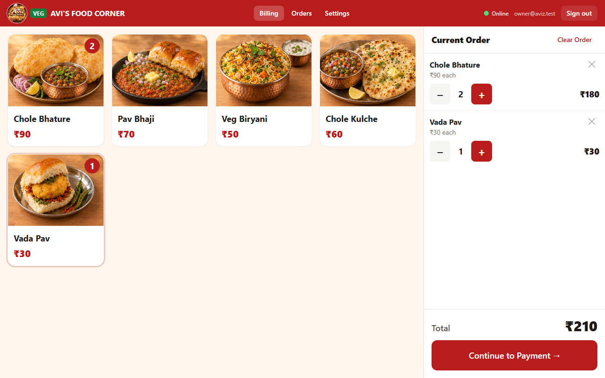

# Avi's Food Corner — Cloud POS

A fast, touch-first point-of-sale web app for **Avi's Food Corner**, a vegetarian Indian food stall.
It runs full-screen on an Android tablet beside the counter. The cashier taps food photos, takes Cash or
UPI, and a Bluetooth thermal printer prints the receipt. An ordinary order takes about 10 seconds.



## What it does

| Area | Highlights |
|---|---|
| **Billing** | Large photo cards; one tap = +1; live quantity badges; +/−/remove; Clear Order with confirmation; grand total always visible |
| **Payment** | Cash or UPI only. UPI needs an explicit "customer has paid" confirmation; picking UPI never marks an order paid. Double-submit proof. |
| **Receipts** | 58 mm / 80 mm. Silent auto-print to a Bluetooth (BLE) ESC/POS printer, with a browser-print fallback. Retry and reprint never create a second sale. |
| **Offline-safe** | Orders made without internet are stored on the tablet, clearly flagged, and sync automatically when the connection returns. |
| **Owner area** | PIN-protected Settings: products (name, price, photo, available, on/off menu), business & receipt text, printer, staff accounts |
| **Reports** | Orders by date range, search by order number, order details, reprint, cancel/refund with reason, daily summary (Cash vs UPI, quantity per product), CSV export |
| **Security** | Owner/cashier roles, Firestore rules that reject tampered orders, server-side re-validation of every order, append-only audit log, sales never deletable |

## Tech stack

- **Frontend:** React 18 + TypeScript + Vite + Tailwind CSS, installable **PWA** (works full-screen, landscape)
- **Hosting:** Netlify (auto-deploys from GitHub; config in `netlify.toml`)
- **Backend:** Firebase — Firestore (with offline persistence), Authentication, Cloud Storage,
  Cloud Functions (Node 22, region `asia-south1` Mumbai)
- **Money** is stored as **integer paise** everywhere; every order keeps a price snapshot, so later price
  changes never alter past receipts or reports.

```
 Android tablet (Chrome / installed PWA)
 ┌───────────────────────────────────────────┐        ┌──────────────── Firebase ────────────────┐
 │ Billing ─ Payment ─ Orders ─ Settings     │        │ Auth (owner / cashier roles)             │
 │   │ Firestore SDK + offline IndexedDB ────┼──────► │ Firestore  ── security rules             │
 │   │ (orders queue & sync when online)     │        │   └─► Cloud Functions: validate orders,  │
 │   └ Web Bluetooth ──► BLE thermal printer │        │       reconcile offline numbers, audit,  │
 └───────────────────────────────────────────┘        │       staff management                   │
                                                      │ Storage (product photos)                 │
                                                      └──────────────────────────────────────────┘
 The app itself is served by Netlify (HTTPS), auto-deployed from GitHub.
```

## Quick start (local, no cloud account needed)

Requires Node 20+ (22 recommended), the Firebase CLI (`npm i -g firebase-tools`) and Java 21 (for the emulators).

```bash
npm install
npm --prefix functions install
npm run dev:emu          # Firebase emulators + app at http://localhost:5173
```

In a second terminal, load the menu and create an owner login (local emulators only):

```bash
npm run seed -- --emulator
npm run bootstrap-owner -- owner@aviz.test "Owner@12345" --emulator
```

Open <http://localhost:5173> and sign in. The emulator dashboard is at <http://localhost:4000>.

## Scripts

| Command | What it does |
|---|---|
| `npm run dev:emu` | Local emulators + app (safe sandbox, nothing leaves the computer) |
| `npm run dev` | App against the real Firebase project in `.env` |
| `npm test` | Unit tests (cart, money, receipts, reports, server validation) |
| `npm run test:rules` | Firestore security-rules tests (starts the Firestore emulator itself) |
| `npm run test:e2e` | Full acceptance test in a real browser (needs `npm run dev:emu` running) |
| `npm run typecheck` | TypeScript check |
| `npm run build` | Production build into `dist/` (Netlify runs this automatically) |
| `npm run deploy` | Deploy the Firebase backend: Firestore/Storage rules + Cloud Functions |
| `npm run seed` / `npm run bootstrap-owner` | One-off setup scripts (add `-- --emulator` for local) |

## Documentation

| Guide | For |
|---|---|
| [docs/DEPLOY.md](docs/DEPLOY.md) | Going live: Firebase backend + Netlify website |
| [docs/ENV.md](docs/ENV.md) | Configuration files and how secrets are handled |
| [docs/SETUP.md](docs/SETUP.md) | Owner's first-time setup: products, prices, photos, receipt, staff |
| [docs/PRINTER.md](docs/PRINTER.md) | Choosing, pairing and troubleshooting the receipt printer |
| [docs/CASHIER_GUIDE.md](docs/CASHIER_GUIDE.md) | One-page guide for cashiers |
| [docs/TEST_CHECKLIST.md](docs/TEST_CHECKLIST.md) | All 15 acceptance tests: automated results + on-device checklist |
| [docs/COSTS.md](docs/COSTS.md) | Hosting, database, printer and other running costs |
| [docs/BACKUP.md](docs/BACKUP.md) | Backups and the recovery process |

## Project layout

```
src/
  app/          routing, auth & role guards, layout, offline banner, shared live data
  screens/      Login, Billing, Payment, Orders, OrderDetail, Settings (+ settings/ tabs)
  components/   ProductCard, OrderPanel, QtyStepper, ReceiptPreview, ConfirmDialog, Toast…
  store/        cart (Zustand, persisted so a refresh never loses an order)
  data/         Firestore/Storage repositories (products, orders, settings, staff, images)
  printer/      receipt layout, ESC/POS encoder, Web Bluetooth driver, browser-print fallback
  payments/     UPI confirmation strategy (manual now; gateway can be plugged in later)
  lib/          types, money (paise), formatting, reports/CSV, ids, Firebase init
functions/src/  Cloud Functions (validation, offline-number reconciliation, audit, staff)
scripts/        seed + bootstrap-owner (Admin SDK)
tests/          unit tests, rules/ (security rules), e2e/ (browser acceptance test)
firestore.rules · storage.rules · firebase.json
```

## Status

All automated checks pass: 31 unit tests, 21 security-rules tests and 41 end-to-end browser checks
covering acceptance tests 1–15. **It is not production-ready until the real tablet + printer workflow has
been tested.** Bluetooth printing in particular can only be proven on the actual hardware; see
[docs/TEST_CHECKLIST.md](docs/TEST_CHECKLIST.md).
